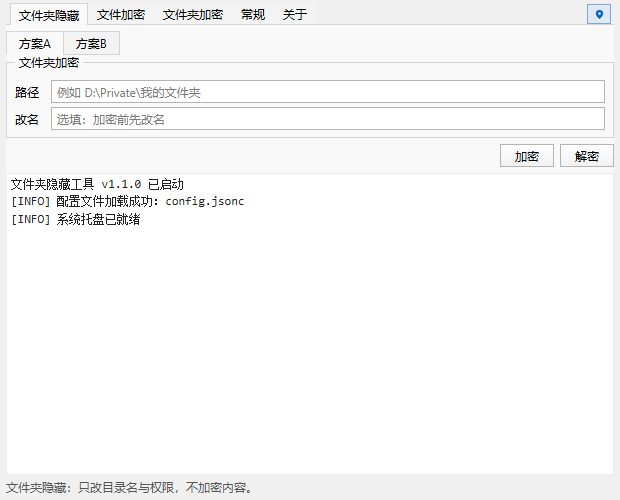
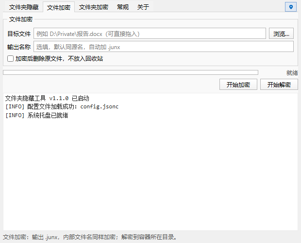
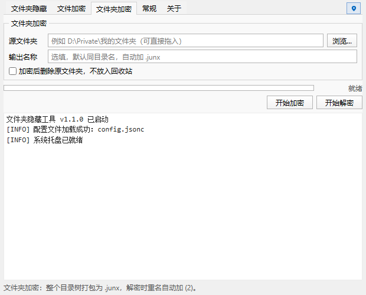
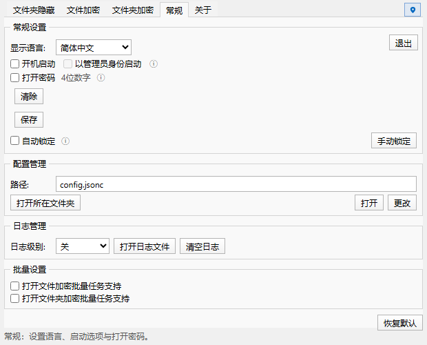

# 文件夹隐藏工具（Folder Hide Tool）

基于 **Wails 3 + Go** 的 Windows 桌面小工具：既可以让文件夹双击无法打开，也可以把单个文件或整个目录树用 **AES-256-GCM** 打包成 `.junx` 加密容器。界面提供简体中文 / English / 日本語三种语言。

> 当前版本：`1.1.0`　|　平台：Windows 10 / 11（amd64）
>
> 完整文档：[产品文档站](https://junx-folder-encryption.workers.dev) · [下载发行版](https://github.com/WangWangZhou/junx-folder-encryption/releases) · [开发文档](https://junx-folder-encryption.workers.dev/dev/project-structure/)

---

## 1. 功能简介

### 1.1 文件夹隐藏

提供两种方案，让目标文件夹在资源管理器中无法正常双击打开：

- **方案A（尾随点）**：给目录名追加 `..` 并设为隐藏；解密时去掉后缀并恢复显示。
- **方案B（ACL 限制）**：为当前用户添加拒绝列目录的权限，并隐藏目录；解密时先恢复权限再清理元数据。

两种方案都支持加密 / 解密往返，方案A 可同时改名；失败时自动回滚。

### 1.2 文件与文件夹加密

- **文件加密**：把单个文件打包为 `原名.junx`。
- **文件夹加密**：把整个目录树（含空目录）打包为一个 `.junx`。
- 源路径支持直接输入、「浏览…」选择，以及从资源管理器拖入窗口。
- 输出名称留空时使用源名称，自动补 `.junx`；解密固定输出到容器所在目录，同名自动改为 `(2)`、`(3)`，不覆盖原文件。
- 两个加密页都能解开任意 `.junx` 容器，无需事先判断类型。
- 加密后可选择删除原文件 / 原文件夹，仅在校验成功后弹出二次确认；删除为永久删除，不进入回收站。

### 1.3 批量任务

- 在「常规 → 批量设置」开启对应支持后，加密页出现「批量」按钮。
- 把多个文件或文件夹拖入队列，首个条目决定任务性质（加密或解密），串行执行。
- 支持小图标 / 列表两种视图，排队任务可暂停、恢复、删除，运行中可查看进度。

### 1.4 常规设置与锁屏

- 显示语言、开机启动、以管理员身份启动、窗口置顶。
- 配置管理：查看 / 打开配置文件、打开所在文件夹、迁移配置目录、恢复默认。
- 日志管理：四级日志级别、打开当天日志、清空界面日志。
- 锁屏密码：4 位数字，手动锁定与空闲 15 分钟自动锁定；未解锁时拒绝加解密操作。

### 1.5 系统托盘与单实例

- 启动即常驻系统托盘；左键切换窗口显示 / 隐藏，右键菜单提供「显示主窗口」和「退出」。
- 点击窗口 X 只隐藏到托盘，程序继续运行。退出请使用托盘菜单或「常规 → 常规设置」右上角的「退出」按钮。
- 从托盘恢复时，窗口回到上次关闭的位置与大小；多显示器环境会记住原屏幕，拔屏后回退主屏居中。
- 重复双击 exe 不会启动第二个进程或出现第二个托盘图标，已有窗口会被带回并置前。

---

## 2. 界面截图

截图存放于 [`website/public/screenshots/`](website/public/screenshots/)，仅作展示，不参与桌面端构建。

*文件夹隐藏：方案A / 方案B 与底部日志区*

*文件加密：源路径、输出名称与加密 / 解密*

*文件夹加密：目录树打包为单个 .junx*

*常规设置：语言、启动、锁屏、配置与日志管理*

---

## 3. 快速使用

### 3.1 文件夹隐藏

1. 在「文件夹隐藏」下切换「方案A」或「方案B」，输入目标文件夹的完整路径。
2. 点击「加密」使文件夹无法双击打开；点击「解密」恢复正常访问。
3. 方案A 解密时需填写带 `..` 后缀的完整路径（加密成功后输入框会自动更新）；方案B 解密填原路径即可。

### 3.2 文件 / 文件夹加密

1. 切到「文件加密」或「文件夹加密」，通过输入、拖入或「浏览…」选定源路径。
2. 输出名称留空即用源名称；如需保留原件，不要勾选「删除原文件」。
3. 点击「开始加密」，进度条依次显示 扫描 → 打包 → 加密 → 写盘 → 校验 → 完成。
4. 解密时点「开始解密」，输出到容器所在目录，同名自动 `(2)(3)`。

### 3.3 批量任务

1. 「常规 → 批量设置」勾选对应支持项，回到加密页点最左的「批量」。
2. 把文件 / 文件夹拖到高输入框里，第一个决定任务性质；不合规的条目会在日志里给出原因。
3. 点「开始加密」/「开始解密」串行执行；面板中可切换小图标 / 列表，排队任务可暂停、恢复、删除。

### 3.4 托盘与退出

1. 程序启动后托盘图标常驻；点窗口 X 只是隐藏窗口，程序继续运行。
2. 左键单击托盘图标恢复 / 隐藏窗口，右键单击打开菜单；恢复时窗口回到上次关闭的位置与大小。
3. 再次双击 exe 不会启动第二个应用：已有窗口会被带回并恢复位置，托盘图标始终只有一个。
4. 退出程序有两种方式：托盘菜单「退出」，或「常规 → 常规设置」右上角的「退出」按钮。

### 3.5 配置与日志

- 配置文件默认位于 `%AppData%\FolderHideTool\config.jsonc`，可在「常规 → 配置管理」中打开或迁移目录。
- 「恢复默认」会重置偏好并清除锁屏密码，但保留配置文件路径。
- 日志按天写入 `%AppData%\FolderHideTool\logs\`；「清空日志」只清空界面显示，不删除磁盘文件。

---

## 4. 安全提醒

1. **文件夹隐藏不是加密**。方案A 只是改名，方案B 只是 ACL 限制；7-Zip、WSL、命令行或管理员账户仍可访问。只有 `.junx` 才是加密容器。
2. `.junx` 的密钥内置在程序里，适合防误看、防随手打开，不适合对抗专业取证，也没有密码找回机制。
3. 方案B 仅对 NTFS 有效；元数据写在文件夹内部，损坏或丢失后无法自动恢复权限。
4. 锁屏密码固定 4 位、密钥硬编码，仅用于防止本机误用，不是安全边界。
5. 不要在 OneDrive 等同步目录、系统目录或程序安装目录使用，操作前请自行备份。

详细的技术边界、构建方式与测试覆盖见 [开发文档](https://junx-folder-encryption.workers.dev/dev/project-structure/)。
